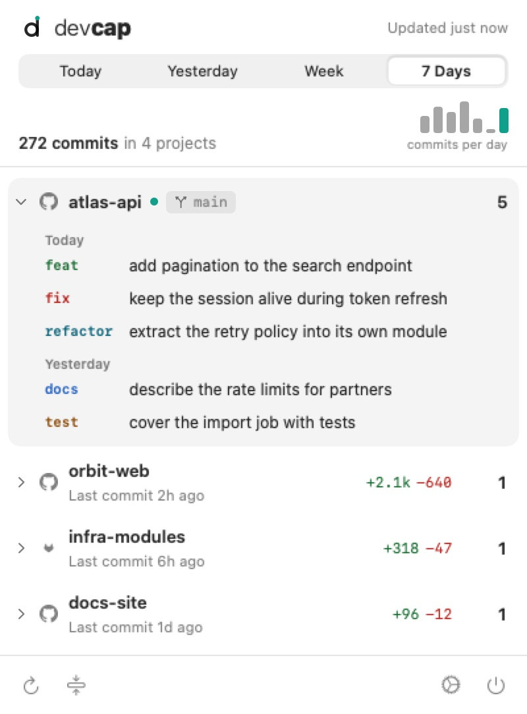

<div align="center">

<picture>
  <source media="(prefers-color-scheme: dark)" srcset="docs/images/devcap-app-logo-dark.svg">
  
</picture>

# devcap.app

Native macOS menubar app for <a href="https://github.com/konradmichalik/devcap">devcap</a>: your commits by project and branch, one click away.



</div>

---

## ✨ Features

- **Menubar-native**: lives in the menubar, no Dock icon. An optional count next to the icon shows projects, branches or commits. The icon's dot dims when the period has no commits, pulses while scanning and turns mint when commits arrived since you last opened the popover
- **Worklog by project and branch**: expand a project to see its commits grouped by day. A project with a single branch shows it as a chip instead of an extra level
- **At a glance**: commit totals, the age of each project's last commit and, for Week and 7 Days, a chart of commits per day
- **Conventional commit types**: `feat`, `fix`, `refactor` and others in color, plus added and removed lines per project and, on hover, per commit
- **Flexible time periods**: Today, Yesterday, Week and 7 Days
- **Auto-refresh**: off, or every 5, 15 or 30 minutes
- **Context menus**: open a project in Finder, Terminal or the browser, copy a path, branch name, commit hash or message
- **Parallel scanning**: powered by [rayon](https://github.com/rayon-rs/rayon) via devcap-core
- **Export for external apps** _(opt-in)_: writes a small `data.json` snapshot on an interval, see [Export](#export-data-for-external-apps)

## 🔥 Installation

### Homebrew

[](https://github.com/konradmichalik/homebrew-tap)
[](https://github.com/konradmichalik/homebrew-tap)

```bash
brew install --cask konradmichalik/tap/devcap-app
```

> [!NOTE]
> Requires macOS 14 or later and `git` on `$PATH`. The author filter defaults to `git config --global user.name`.

### Update

```bash
brew upgrade --cask konradmichalik/tap/devcap-app
```

### Download

Grab the latest `.dmg` from [Releases](https://github.com/konradmichalik/devcap-app/releases), open it and drag the app to Applications.

> [!TIP]
> To build from source, see [docs/DEVELOPMENT.md](docs/DEVELOPMENT.md).

## ⚙️ Configuration

Open Settings with the gear in the popover or by right-clicking the menubar icon.

| Tab | Options |
|-----|---------|
| General | Scan folder (default `~/Sites`), auto-refresh (default 15 minutes) |
| Display | Sort projects by latest activity, name or commit count. Colored commit types, provider icons, diff statistics. Count next to the menubar icon: none, projects, branches or commits. A live preview shows the effect |
| Export | Data for other apps, see below |
| About | Version and update check |

### Export data for external apps

When enabled under Settings, Export, devcap.app scans in the background and writes a snapshot with today's and this week's commit counts and the most active project to:

```text
~/Library/Application Support/com.konradmichalik.devcap/data.json
```

The file is written atomically with `0600` permissions and removed as soon as the setting is turned off. Reveal shows it in Finder. Consumers such as a Stream Deck plugin read it from there.

## 📚 Documentation

| Topic | What's inside |
|-------|---------------|
| [Development](docs/DEVELOPMENT.md) | Architecture, data flow, the Rust FFI boundary, building from source, tests, linting and the brand assets |
| [Release](docs/RELEASE.md) | Version bump, tagging, code signing and notarization |

## ⭐ License

This project is licensed under [MIT](LICENSE).
